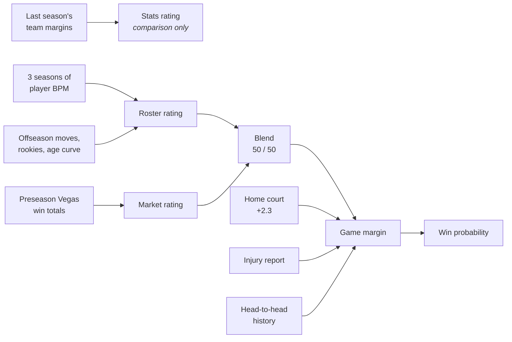

# NBA Week 1 Prediction Model (2026-27)

A transparent model that predicts the winner of every NBA team's **first game of the 2026-27 season**, built step by step from public data and checked against the betting market.

Week 1 is a cold-start problem: there are no current-season games to learn from. So instead of machine learning on recent form, the model estimates **how good each team is right now** from three independent angles, blends them, and turns the rating gap into a win probability.

## Predictions vs. the betting market

<!-- PREDICTIONS TABLE START -->
| Date | Matchup | Model pick | Model win % | Market pick | Market win % | Model line | Market line | Diff (pts) |
|---|---|---|---:|---|---:|---|---|---:|
| Oct 20 | Celtics @ Pistons | **Pistons** | 51% | Pistons | 53% | Pistons −0.2 | Pistons −1.5 | −1.3 |
| Oct 20 | 76ers @ Knicks | **Knicks** | 55% | Knicks | 66% | Knicks −1.5 | Knicks −5.5 | −4.0 |
| Oct 20 | Thunder @ Spurs | **Spurs** | 53% | Spurs | 56% | Spurs −0.9 | Spurs −2.5 | −1.6 |
| Oct 21 | Timberwolves @ Heat | **Heat** | 53% | Heat | 51% | Heat −1.0 | Heat −1.5 | −0.5 |
| Oct 21 | Warriors @ Lakers | **Lakers** | 65% | Lakers | 65% | Lakers −4.7 | Lakers −5.5 | −0.8 |
| Oct 21 | Kings @ Clippers | **Clippers** | 63% | Clippers | 62% | Clippers −4.3 | Clippers −4.5 | −0.2 |
| Oct 21 | Suns @ Blazers | **Blazers** | 59% | Blazers | 60% | Blazers −3.0 | Blazers −3.5 | −0.5 |
| Oct 21 | Mavericks @ Rockets | **Rockets** | 69% | Rockets | 74% | Rockets −6.3 | Rockets −7.5 | −1.2 |
| Oct 21 | Jazz @ Grizzlies | **Jazz** | 53% | Jazz | 53% | Jazz −0.8 | Jazz −1.5 | −0.7 |
| Oct 21 | Pacers @ Pelicans | **Pacers** | 56% | Pacers | 59% | Pacers −2.0 | Pacers −3.5 | −1.5 |
| Oct 21 | Bulls @ Raptors | **Raptors** | 77% | Raptors | 77% | Raptors −9.1 | Raptors −8.5 | +0.6 |
| Oct 21 | Hornets @ Nets | **Hornets** | 57% | Hornets | 54% | Hornets −2.3 | Hornets −2.5 | −0.2 |
| Oct 21 | Bucks @ Wizards | **Wizards** | 62% | Wizards | 67% | Wizards −3.9 | Wizards −5.5 | −1.6 |
| Oct 21 | Hawks @ Magic | **Magic** | 61% | Magic | 57% | Magic −3.3 | Magic −2.5 | +0.8 |
| Oct 22 | Cavaliers @ 76ers | **76ers** | 61% | 76ers | 56% | 76ers −3.5 | 76ers −2.5 | +1.0 |
| Oct 22 | Nuggets @ Thunder | **Thunder** | 71% | Thunder | 72% | Thunder −6.9 | Thunder −8.5 | −1.6 |

*Model and market pick the same winner in **16 of 16** games. Average difference: **1.1 points**. When the market favors a team by 4+, it expects 6.5 points on average; the model expects 5.2.*

*Diff = model margin minus market spread, from the market favorite's side (negative = the model is less confident in the favorite). ⚠️ = different pick. Market win % is the moneyline with the bookmaker's margin removed. Lines: covers.com, captured before tip-off. Generated Oct 20, 2026.*
<!-- PREDICTIONS TABLE END -->

Regenerate this table with `python3 compare_lines.py --update-readme`.

## How it works



Every rating is in the same unit: **points per game better than an average team**.

### 1. Stats rating (baseline)
Last season's point differential per game, shrunk 35% toward zero (`REGRESS = 0.65`), because good teams tend to get worse and bad teams tend to get better from luck, aging and injuries. It's printed for comparison but isn't part of the final blend: the roster rating replaced it.

### 2. Market rating
Preseason over/under win totals already price in every roster move, so they're converted back into points per game. The exchange rate (about **2.17 wins per point of margin**) is fit from last season's data, not assumed.

### 3. Roster rating (the core of the model)
Each 2026-27 roster is rebuilt player by player:

- **Player value = BPM (Box Plus/Minus)**, combined across three seasons with weights **1.0 / 0.6 / 0.36**. Older seasons are first moved forward with the age curve. Small samples are shrunk toward a prior of −1.0, worth 250 minutes, so 150 good minutes don't make a star.
- **Age curve** is learned from 579 player-season pairs. Players 21 and under improve about +0.9 BPM per year, 22–23-year-olds about +0.5, then there's a slow decline that gets steeper after 36.
- **Offseason moves** (`data/transactions.csv`) put each player on his new team.
- **Rookies** get the expected BPM and minutes of their draft slot, learned from the 2025 class's actual rookie seasons: about +1.4 BPM for the #1 pick down to −3.6 for #30.
- **240 minutes per team** go to players in order of their usual minutes per game. Team strength is the sum of BPM × share of the game played.
- A calibration fit maps the roster sum to real margins. On last season's end-of-season rosters it correlates **0.87** with actual point differential.

### 4. Game-level adjustments
- **Home court:** +2.3 points for every home team.
- **Injuries:** the 240-minute allocation is rerun without the injured players, so their minutes go to the next players in line. Questionable counts as a 50% chance of sitting.
- **Head-to-head:** the gap between past meetings and what the teams' ratings predicted, shrunk heavily (only about 11% kept for 8.5 effective games), with playoff games counted at half weight. It's scaled by both teams' **roster continuity**, so the edge fades as the players who created it leave.
- **New head coach:** an optional penalty, off by default (`NEW_COACH_PENALTY = 0`), to be tested once results are in.

### 5. Margin → win probability
NBA results scatter around the expected margin with a standard deviation of about 12.5 points, so `P(win) = NormalCDF(margin / 12.5)`. A 7-point favorite wins about 71% of the time.

## Backtesting the player projections

`backtest_weights.py` pretends it's October 2025, predicts each player's 2025-26 BPM from 2023-24 and 2024-25 only, and scores the predictions against what actually happened (336 players with 500+ minutes; the age curve is fit without peeking at 2025-26).

| Method | Error (RMSE, BPM points) |
|---|---|
| Guess everyone is average | 2.94 |
| Last season's raw BPM | 2.20 |
| Last season, shrunk | 1.86 |
| **+ older season at 0.5–0.75 weight** | **1.76** |

Shrinkage does most of the work. The older season adds a smaller but real gain, and the best weight is a flat range rather than a sharp peak.

## Project structure

```
model.py                 the model: ratings, adjustments, predictions
compare_lines.py         model vs. betting lines; writes results/ and the README table
backtest_weights.py      tests how much older seasons should count
archive/model_v1.py      the first version (stats + market only), kept for reference
results/
  predictions.csv        every game, every model's win probability
  predictions_vs_market.md
data/
  last_season_2025_26.csv   team records and point differential
  win_totals_2026_27.csv    preseason Vegas win totals
  advanced_20XX_XX.csv      Basketball-Reference advanced stats (see Data below)
  transactions.csv          offseason moves: player -> new team
  overrides.csv             players without recent stats (blank = use history)
  draft_2025.csv, draft_2026.csv
  injuries.csv              game-day injury report
  coaches.csv               teams with new head coaches
  h2h_games.csv             past head-to-head meetings
  first_games.csv           the matchups being predicted
  market_lines.csv          spreads and moneylines for each game
```

## Running it

```bash
pip install -r requirements.txt
python3 model.py                        # ratings, predictions, diagnostics
python3 model.py --coach-penalty 1.0    # try the new-coach hypothesis
python3 compare_lines.py                # model vs. betting market
python3 backtest_weights.py             # season-weight backtest
```

All the settings are constants at the top of `model.py`:

| Setting | Value | Meaning |
|---|---|---|
| `REGRESS` | 0.65 | Share of a rating kept; the rest is pulled toward average |
| `HOME_COURT` | 2.3 | Points for the home team |
| `MARGIN_SD` | 12.5 | Spread of real results around the expected margin |
| `MARKET_WEIGHT` | 0.5 | Vegas vs. roster model in the blend |
| `SEASONS` | 1.0 / 0.6 / 0.36 | Weight of each season of player data |
| `BPM_PRIOR`, `BPM_PRIOR_MIN` | −1.0, 250 | Small-sample shrinkage |
| `REPLACEMENT` | −2.0 | BPM of a freely available fill-in player |
| `QUESTIONABLE_WEIGHT` | 0.5 | Chance a questionable player sits |
| `MATCHUP_SD` | 1.5 | Assumed size of real head-to-head edges |
| `NEW_COACH_PENALTY` | 0.0 | Points against a team with a new coach (off) |

## Data

| Data | Source |
|---|---|
| Player advanced stats, 2023-24 to 2025-26 | [Basketball-Reference](https://www.basketball-reference.com/leagues/NBA_2026_advanced.html) (Share & Export → CSV) |
| 2025-26 standings and point differential | champsorchumps.us |
| Preseason win totals | BetMGM via statsniper.com (Sept 11, 2026) |
| Offseason transactions | Dunkest offseason tracker, AP offseason recap |
| 2026 draft | NBC Sports draft tracker |
| Injury reports | Official team reports via news coverage (Oct 19–20) and Fantasy Alarm (Oct 15) |
| Betting lines | Covers.com (opening lines, Oct 20) |

The Basketball-Reference CSVs are excluded from the repository by default (see `.gitignore`). To run the model, download the three advanced-stats tables and save them in `data/` as `advanced_2023_24.csv`, `advanced_2024_25.csv` and `advanced_2025_26.csv`.

## Known limitations

- **Ratings are compressed.** Market favorites by 4+ are expected to win by 6.5 on average; the model expects 5.2. Player shrinkage and `REGRESS` both pull toward average. A team-level backtest should set this properly.
- **Team effects are lost.** Some teams beat the sum of their players' BPM (last season: Pistons +5.4, Spurs +3.5), and the roster rating ignores this.
- **Minutes come from last season's playing time**, so improving young players (e.g. Dylan Harper) can be squeezed out of the projected rotation by veterans.
- **Fixed home court and untested settings** (`HOME_COURT`, `MATCHUP_SD`) still need game-level data to check.
- **No rest, travel or back-to-back effects.** Second-round picks and undrafted players aren't modeled.

## Next steps

1. Grade every game with Brier score, for both the model and the market.
2. Team-level backtest to fix compression and test whether team effects carry over.
3. Project minutes from player quality and age, not only last season's playing time.

---

*A learning project, not betting advice.*
